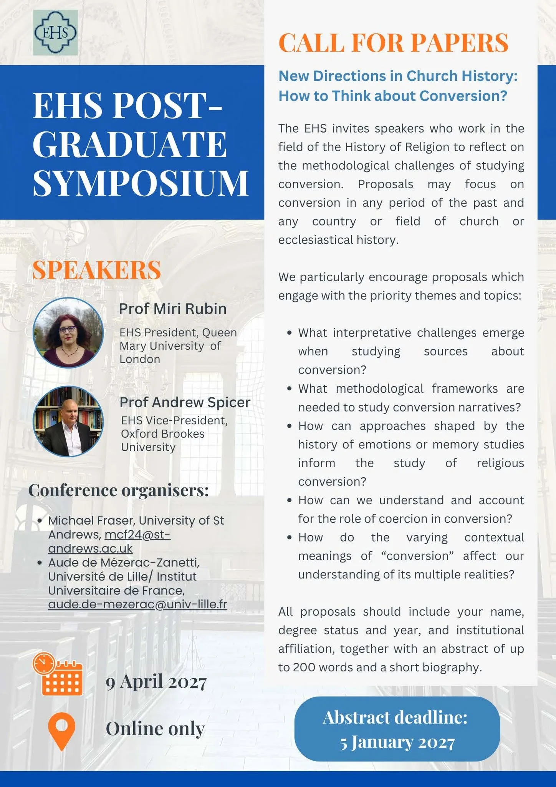
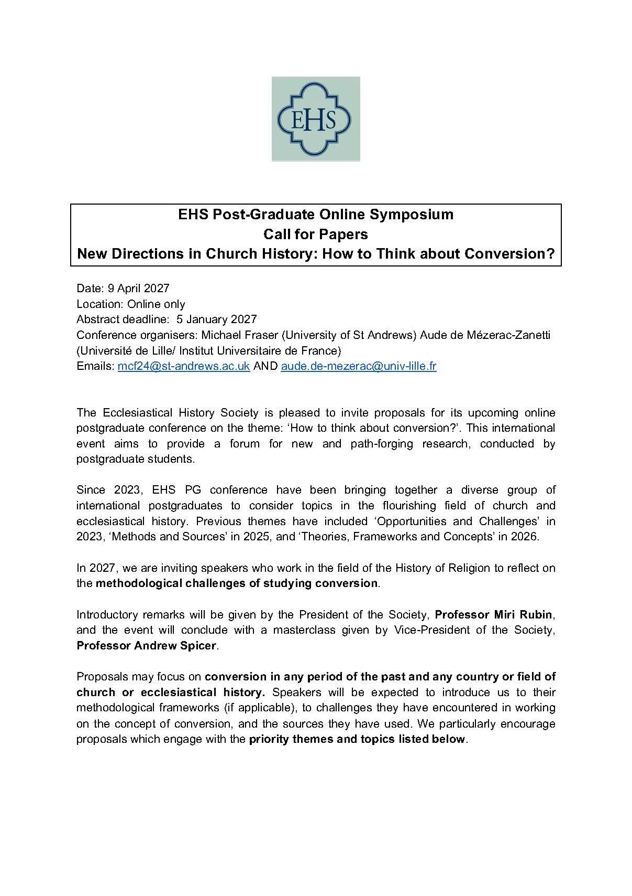
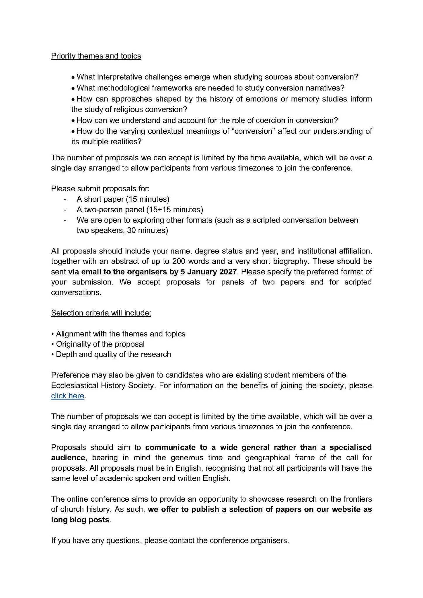

## EHS Post-Graduate Online Symposium Call for Papers

### New Directions in Church History: How to Think about Conversion?

- **Date:** 9 April 2027
- **Location:** Online only
- **Abstract deadline:** 5 January 2027
- **Conference organisers:** Michael Fraser (University of St Andrews) and Aude de Mézerac-Zanetti (Université de Lille/Institut Universitaire de France)
- **Emails:** [mcf24@st-andrews.ac.uk](mailto:mcf24@st-andrews.ac.uk) AND [aude.de-mezerac@univ-lille.fr](mailto:aude.de-mezerac@univ-lille.fr)

The Ecclesiastical History Society is pleased to invite proposals for its upcoming online postgraduate conference on the theme: ‘How to think about conversion?’. This international event aims to provide a forum for new and path-forging research, conducted by postgraduate students.

Since 2023, EHS PG conference have been bringing together a diverse group of international postgraduates to consider topics in the flourishing field of church and ecclesiastical history. Previous themes have included ‘Opportunities and Challenges’ in 2023, ‘Methods and Sources’ in 2025, and ‘Theories, Frameworks and Concepts’ in 2026.

In 2027, we are inviting speakers who work in the field of the History of Religion to reflect on the **methodological challenges of studying conversion**.

Introductory remarks will be given by the President of the Society, **Professor Miri Rubin**, and the event will conclude with a masterclass given by Vice-President of the Society, **Professor Andrew Spicer**.

Proposals may focus on **conversion in any period of the past and any country or field of church or ecclesiastical history.** Speakers will be expected to introduce us to their methodological frameworks (if applicable), to challenges they have encountered in working on the concept of conversion, and the sources they have used. We particularly encourage proposals which engage with the **priority themes and topics listed below**.

### Priority themes and topics

- What interpretative challenges emerge when studying sources about conversion?
- What methodological frameworks are needed to study conversion narratives?
- How can approaches shaped by the history of emotions or memory studies inform the study of religious conversion?
- How can we understand and account for the role of coercion in conversion?
- How do the varying contextual meanings of “conversion” affect our understanding of its multiple realities?

The number of proposals we can accept is limited by the time available, which will be over a single day arranged to allow participants from various timezones to join the conference.

Please submit proposals for:

- A short paper (15 minutes)
- A two-person panel (15+15 minutes)
- We are open to exploring other formats (such as a scripted conversation between two speakers, 30 minutes)

All proposals should include your name, degree status and year, and institutional affiliation, together with an abstract of up to 200 words and a very short biography. These should be sent **via email to the organisers by 5 January 2027**. Please specify the preferred format of your submission. We accept proposals for panels of two papers and for scripted conversations.

### Selection criteria will include:

- Alignment with the themes and topics
- Originality of the proposal
- Depth and quality of the research

Preference may also be given to candidates who are existing student members of the Ecclesiastical History Society. For information on the benefits of joining the society, see the Ecclesiastical History Society website.

The number of proposals we can accept is limited by the time available, which will be over a single day arranged to allow participants from various timezones to join the conference.

Proposals should aim to **communicate to a wide general rather than a specialised audience**, bearing in mind the generous time and geographical frame of the call for proposals. All proposals must be in English, recognising that not all participants will have the same level of academic spoken and written English.

The online conference aims to provide an opportunity to showcase research on the frontiers of church history. As such, **we offer to publish a selection of papers on our website as long blog posts**.

If you have any questions, please contact the conference organisers.

[Read the original call](https://www.churchhistory.org/ehs-post-graduate-online-symposium-call-for-papers-new-directions-in-church-history-how-to-think-about-conversion)

